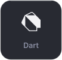
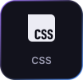
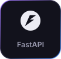
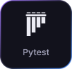
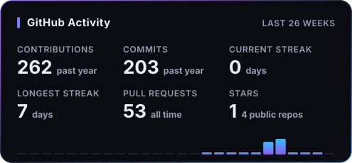
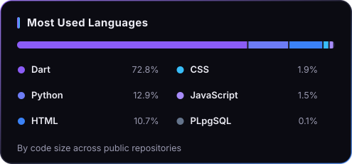

  

  

 

## About Me

I'm Zain, a software developer who builds practical applications from end to end: Flutter apps on the front, and the Python APIs and databases behind them.

Most of my time goes into **Waffr**, an offline-first finance app with its own FastAPI and PostgreSQL sync backend. Along the way I've become interested in local-first data and sync, application security, and Arabic right-to-left interfaces. I also build responsive, animated web pages with plain HTML, CSS and JavaScript.

I care about clear architecture, documented code and tests, and I'm still learning more web development.

 

## Currently Building

### [Waffr](https://github.com/zain-28a/waffr)

A personal and family finance app for tracking spending, bills and savings. It works fully offline, and syncs across devices when you sign in.

- **App:** Flutter, with an Arabic right-to-left interface in light and dark themes. Tracks income, expenses, recurring bills, savings goals and a shopping list. Includes on-device spending insights, charts, PDF export, reminders, home screen widgets and a biometric app lock.
- **Backend:** a FastAPI service on PostgreSQL with SQLAlchemy that merges data from each device through a single sync endpoint. It uses JWT sign-in, Argon2 password hashing, row-level security, rate limiting and client-side encryption for private text such as notes and categories.
- **Engineering:** the code is split by feature and every folder has its own README. Tests run with `flutter test` and pytest, a GitHub Actions workflow builds the Android APK, and the API is deployed on Render.

 

## Tech Stack

**Languages**

  
  
  
  
  

**Mobile & Backend**

  
  
  
  

**Tools & Delivery**

  
  
  
  

 

## Featured Projects

### [Waffr](https://github.com/zain-28a/waffr)

An offline-first finance app for spending, bills and savings. It has an Arabic right-to-left interface, on-device insights and encrypted cloud sync through its own API.

`Flutter` `Dart` `FastAPI` `PostgreSQL` `SQLAlchemy` `Pytest`

### [Youth Guide](https://github.com/zain-28a/youthguide-page) &nbsp;·&nbsp; [Live site](https://zain-28a.github.io/youthguide-page/)

An Arabic (RTL) landing page for the Youth Guide initiative. It uses scroll-driven scenes, a logo that moves between sections, and a liquid-glass effect I built from SVG displacement filters with pointer-following light. It has light and dark themes and a separate mobile layout.

`HTML` `CSS` `JavaScript` `SVG`

### [AV: AI Chat Interface](https://github.com/zain-28a/av_ai_landing_page)

A landing page and chat interface for an AI assistant project. It has an animated hero, light and dark themes that are remembered between visits, and a chat view with a typing indicator and local import and export of conversations as JSON. It's front-end only, and the assistant's replies are still placeholders.

`HTML` `CSS` `JavaScript`

 

## GitHub Statistics

  
  

  <picture>
    <source media="(prefers-color-scheme: dark)" srcset="https://raw.githubusercontent.com/zain-28a/zain-28a/output/snake-dark.svg" />
    <source media="(prefers-color-scheme: light)" srcset="https://raw.githubusercontent.com/zain-28a/zain-28a/output/snake-light.svg" />
    
  </picture>

 

## Connect With Me

  
  
  

