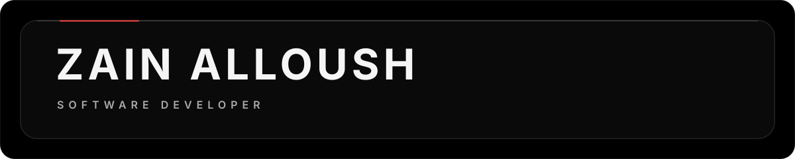
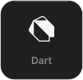
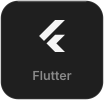
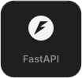
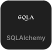
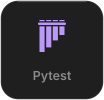
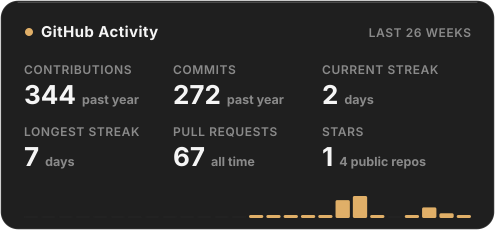
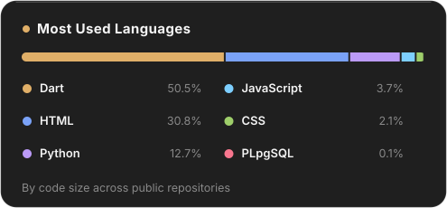

 

## About

I'm Zain, 18, in my senior year of high school. I'm interested in learning computer science and becoming a software developer.

**Languages**

  
  
  
  
  

**Mobile & Backend**

  
  
  
  

**Tools & Delivery**

  
  
  
  

 

## Now

**Building: [Waffr](https://github.com/zain-28a/waffr)**

A finance app that works offline and syncs when you sign in.

- Flutter app with an Arabic interface, savings goals and spending insights
- FastAPI and PostgreSQL sync API with JWT auth, row-level security and encrypted notes
- Tested with `flutter test` and pytest, deployed on Render

**Learning:** Web development, Backend and API design, Data structures and algorithms

 

## Projects

### [Waffr](https://github.com/zain-28a/waffr)

Offline-first finance app with an Arabic interface and its own sync API.

`Flutter` `Dart` `FastAPI` `PostgreSQL`

### [Youth Guide](https://github.com/zain-28a/youthguide-page) &nbsp;·&nbsp; [Live site](https://zain-28a.github.io/youthguide-page/)

Arabic landing page with scroll-driven scenes and a custom liquid-glass effect.

`HTML` `CSS` `JavaScript`

### [AV](https://github.com/zain-28a/av_ai_landing_page)

Landing page and chat interface for an AI assistant. Front-end only so far.

`HTML` `CSS` `JavaScript`

 

## Stats

<picture>
  <source media="(prefers-color-scheme: dark)" srcset="https://raw.githubusercontent.com/zain-28a/zain-28a/output/snake-dark.svg" />
  <source media="(prefers-color-scheme: light)" srcset="https://raw.githubusercontent.com/zain-28a/zain-28a/output/snake-light.svg" />
  
</picture>

 

## Connect

